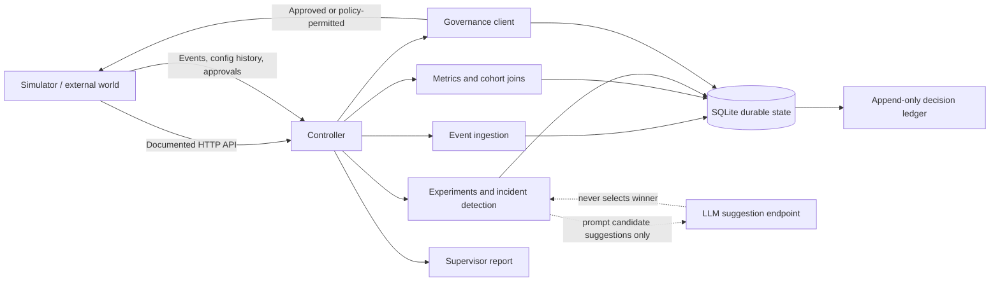
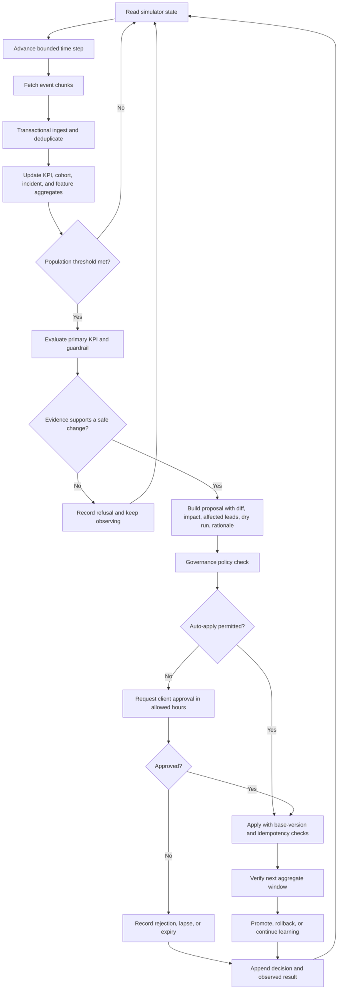
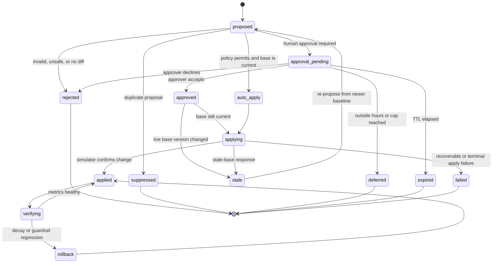
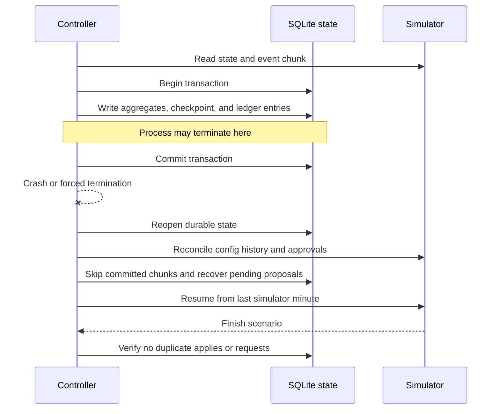

# Formi Outcome-First Agent Controller

An autonomous controller for Formi's outbound voice workflows. It observes workflow events, detects statistically meaningful changes, experiments with agent configuration, routes changes through governance, and records every decision in an auditable local store.

The controller communicates with the supplied simulator over its documented HTTP API. It does not import simulator code, read scenario files, inspect hidden truth, or modify the simulator. The simulator contract is documented in [`docs/SIMULATOR.md`](docs/SIMULATOR.md).

## The problem

Formi workflows must choose how an agent presents itself: welcome message, voice, caller ID, prompt version, and schedule weights. A static configuration becomes stale as populations, caller IDs, prompts, and customer behaviour change.

The controller must improve outcomes without making unsafe or unauthorised changes. Pickup rate and engagement rate are separate KPIs; decisions must use populations rather than individual calls; customer-facing changes need governance; experiments need deterministic statistical decisions; supervisor edits must never be silently overwritten; state must survive crashes; and every decision must be explainable afterwards.

## The solution

The controller is a closed-loop service with five stages:

1. **Ingest** event chunks with transactional checkpoints and idempotency.
2. **Measure** pickup, engagement, conclusion, hallucination, caller-ID, cohort, and schedule metrics using bounded SQLite aggregates.
3. **Experiment** with welcome messages and voices using controlled allocation, minimum sample sizes, confidence tests, practical-effect thresholds, guardrails, and confirmation windows.
4. **Govern** every proposed change through policy validation, auto-apply, or client approval. Prompt changes always use the approval path.
5. **Learn and explain** by promoting winners, detecting decay, rolling back degraded variants, and writing an append-only decision ledger.

The detailed decision model is in [`docs/DECISION_ENGINE.md`](docs/DECISION_ENGINE.md), and the component walkthrough is in [`docs/ARCHITECTURE_WALKTHROUGH.md`](docs/ARCHITECTURE_WALKTHROUGH.md).

## Innovation

The innovation is treating autonomy as a governed learning loop rather than a one-time optimiser:

- One shared cohort model is reused by detection, experiments, and the supervisor report.
- LLM assistance is separated from statistical decisions: the LLM may suggest prompt fixes, but cannot select a winner or apply a change.
- Every proposal carries evidence, a diff, affected-lead estimate, impact estimate, dry-run status, rationale, policy reference, approval status, and observed result.
- Promoted variants retain a control allocation so decay can be detected.
- Supervisor edits become the new baseline, close affected experiments, and freeze edited dimensions from exploration.
- Crash recovery is part of the state machine through atomic chunk commits, deterministic proposal IDs, approval reconciliation, and config-history reconciliation.

Trade-offs and deliberately excluded capabilities are recorded in [`docs/TRADEOFFS.md`](docs/TRADEOFFS.md).

## Changes delivered

- Restartable, idempotent event ingestion with bounded aggregate storage.
- Separate pickup, engagement, and conclusion metrics.
- Feature-based cohort discovery and cohort-specific experiments.
- Deterministic winner selection with sample floors, statistical significance, practical lift, multiple-comparison correction, and guardrails.
- Caller-ID degradation detection and safe rotation.
- Hallucination response: detect → suggest → validate → approve → verify.
- Governance lifecycle with policy checks, approval timing, batching limits, expiry handling, stale-base protection, and reconciliation.
- Decay detection and rollback support.
- Append-only audit ledger and supervisor-facing report.
- Crash-recovery demonstration and public load-test evidence.
- Direct repository-level `pytest` support through [`pytest.ini`](pytest.ini).

## Impact demonstrated

The public incident scenario demonstrates:

- **+29.8% conclusion rate** for `ks_cancel` versus baseline;
- **+21.5% pickup rate** for `ks_cancel` after caller-ID remediation;
- **+10.2% engagement improvement** from validated prompt repair;
- caller-ID degradation detected and recovered;
- supervisor edits adopted without silent overwrite; and
- no duplicate applies or approval requests in the crash test.

Full results are in [`reports/public_02.md`](reports/public_02.md). The development run is in [`reports/public_01.md`](reports/public_01.md).

The load scenario completed at simulated minute 7,200 with 9,737,504 events, 270 decisions, zero malformed events, approximately 630 MB peak RSS, and a 411 MiB SQLite store. Measurements are in [`docs/LOAD_TEST.md`](docs/LOAD_TEST.md) and [`reports/public_03.md`](reports/public_03.md).

## Repository structure

```text
controller/       Controller runtime and decision modules
sim/              Supplied simulator; treated as an external HTTP service
scenarios/        Public simulator scenarios
tests/            Unit and simulator contract tests
scripts/          Crash-recovery evidence runner
docs/             Architecture, governance, operations, and decision design
reports/          Public scenario grades and reliability/load evidence
SUBMISSION.md     Assignment decisions, scope, stakeholder responses
run.sh            Required controller entrypoint
```

## Installation

Python 3.10+ is recommended.

```bash
python -m venv .venv
source .venv/bin/activate       # Windows: .venv\\Scripts\\Activate.ps1
python -m pip install -r requirements.txt
```

## Run the controller

Start a simulator in one terminal:

```bash
python -m sim serve \\
  --scenario scenarios/public_01_dev.yaml \\
  --run-dir runs/mine01
```

Start the controller in another terminal:

```bash
./run.sh http://127.0.0.1:8700
```

The controller runs until the simulator reaches the scenario end. State is stored in `state/` by default. Override it with `CONTROLLER_STATE_DIR=/path/to/state`.

On Windows, use:

```powershell
python -m controller run --url http://127.0.0.1:8700 --state state
```

## Tests and test constraints

Run the complete suite with:

```bash
pytest -q
```

Current result: **32 passed**.

The tests cover statistical promotion/refusal, Bonferroni correction, guardrail regression, thin-window rejection, configuration validation, allocation design, cohort ordering, governance routing, prompt safety, stale bases, deduplication, expiry, ingestion idempotency, malformed-event accounting, append-only ledger invariants, simulator approvals, auto-apply rules, validation, and hard policy rules.

The test boundary is intentional. Unit tests do not claim to prove hidden-scenario performance, production latency, or real client approval behaviour. Those constraints are checked through scenario runs, the load test, and crash recovery. See [`tests/DECISION_CASES.md`](tests/DECISION_CASES.md).

## Grade public scenarios

```bash
python -m sim baseline \\
  --scenario scenarios/public_01_dev.yaml \\
  --run-dir runs/base01

python -m sim grade \\
  --run runs/mine01 \\
  --baseline runs/base01 \\
  --out reports/public_01.md
```

Repeat for `public_02_incidents.yaml`. The checked-in reports are evidence from completed runs.

## Verify crash recovery

```bash
python scripts/crash_recovery.py \\
  --scenario scenarios/public_02_incidents.yaml \\
  --port 8711 \\
  --kill-after 20
```

The script kills the controller mid-run, restarts it using the same durable state, and checks for duplicate applies, duplicate approval requests, stuck submissions, and malformed-event corruption. Evidence is in [`reports/crash_recovery.md`](reports/crash_recovery.md).

## Non-negotiable constraints

1. No live configuration change bypasses governance or an explicitly permitted auto-apply policy.
2. Pickup and engagement remain separate; the primary KPI is optimised while the other KPI is protected as a guardrail.
3. No decision is triggered by one call; detection uses population and evidence thresholds.
4. Winner selection is deterministic and statistical; the LLM never decides what wins.
5. Supervisor edits take precedence and are never silently overwritten.
6. Proposal IDs, checkpoints, approvals, and applied config versions are durable and reconciled after restart.
7. Impact scores, affected-lead counts, and dry runs are labelled as estimates when replay is unavailable.
8. The controller uses only the documented simulator HTTP contract.

Operational assumptions and failure handling are documented in [`docs/OPERATIONS.md`](docs/OPERATIONS.md) and [`docs/FAILURE_SCENARIOS.md`](docs/FAILURE_SCENARIOS.md).

## Architecture



The simulator remains the source of world state. The controller owns its
aggregates, learning state, proposals, approvals, and audit ledger. Detailed
component boundaries are documented in [`docs/ARCHITECTURE.md`](docs/ARCHITECTURE.md).

## Outcome-first decision flow



The controller never treats a single call as evidence. A refusal is also a
decision and is recorded for auditability.

## Governance lifecycle



Prompt changes always take the human approval path. Caller-ID and schedule
changes can use auto-apply only when the workflow policy explicitly permits the
dimension and the allocation shift is within policy.

## Crash-recovery flow



The recovery implementation and latest measured result are documented in
[`scripts/crash_recovery.py`](scripts/crash_recovery.py) and
[`reports/crash_recovery.md`](reports/crash_recovery.md).

## Limitations and next step

The implementation is a single Python process with one SQLite writer. The measured load run fits within the target 4-vCPU/8-GB envelope, but the writer and evaluation loop are the first expected bottlenecks at 10x scale. The next production step is to partition ingestion and evaluation by tenant or workflow group, then maintain read-only rollups for cross-tenant reporting.

The scope decision, stakeholder responses, and known limitations are captured in [`SUBMISSION.md`](SUBMISSION.md).

## Company submission documentation

For an external reviewer, start with [`docs/COMPANY_SUBMISSION.md`](docs/COMPANY_SUBMISSION.md). It gives the executive summary, problem, solution, innovation, impact, evidence, limitations, and review checklist.

- [`docs/QUICKSTART.md`](docs/QUICKSTART.md): installation, local run, CLI inspection, state management, and troubleshooting.
- [`docs/TESTING_AND_EVIDENCE.md`](docs/TESTING_AND_EVIDENCE.md): test strategy, test constraints, expected pytest result, and evidence map.
- [`docs/ARCHITECTURE.md`](docs/ARCHITECTURE.md): system design and component boundaries.
- [`docs/OPERATIONS.md`](docs/OPERATIONS.md): operating model, recovery, and scale considerations.
